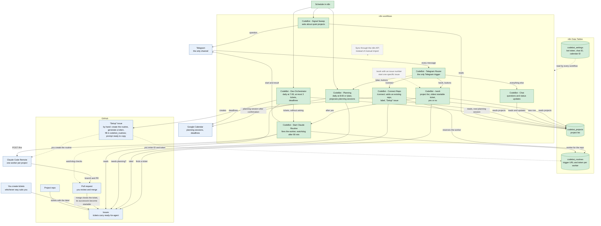

# Overview

The whole system in one diagram: who triggers what, and what each workflow does. Details per workflow are in `workflows.md`.

| Colour | Meaning |
|---|---|
| green | workflow or data table in this repo |
| grey, dashed | not built yet |
| blue | services outside n8n, and steps you do by hand |

Dashed arrows are manual steps or side paths. Solid arrows run on their own.

## The path of a ticket

1. `/connect` in Telegram adds an existing repo as a project: a row in `codebot_projects`, the label `ready-for-agent`, a reserved worker in `codebot_routines`, and a “Setup” issue in the repo.
2. You work through the “Setup” issue once: create the routine on the web (the prompt is in the issue), generate a token, and enter both in `codebot_routines`. Until then, `/work` replies that no worker is set up.
3. CodeBot - Planning proposes a planning session as soon as the project runs out of released tickets. You create the tickets and release them with the label `ready-for-agent` (see `../README.md`).
4. `/work <key>` or the Dev-Orchestrator hands the oldest startable ticket to CodeBot - Start Claude Routine.
5. The project's worker implements it and opens a PR. 90 minutes after the start, the watchdog reports the result in Telegram.
6. You review and merge. That closes the ticket, and its successors become startable.
